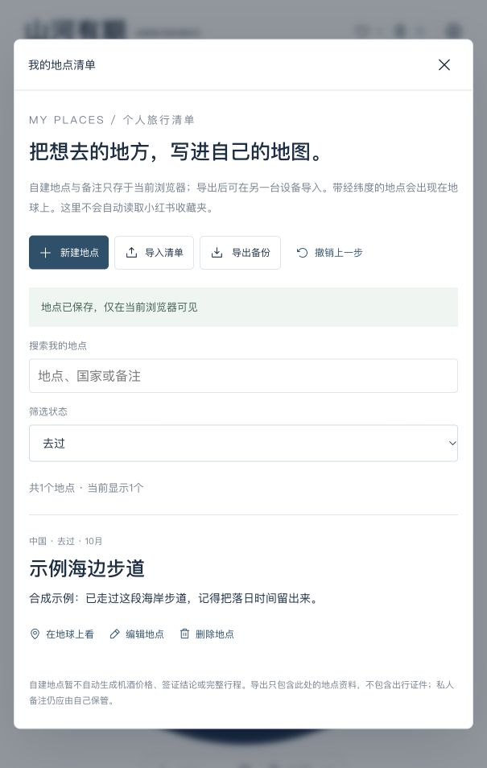

# Soya 山河有期｜旅行年历与个人目的地清单

选一段假期、看看当季风景，把想去的地方保存成自己的旅行清单。
A seasonal travel calendar with a private, browser-local destination list.

[English guide](README.en.md) · 版本0.2.0 · 初始试用版

**[打开在线体验](https://shanhai-youshi.soyoungzsy6.chatgpt.site/)**

例如：你想在10月末用4天、每人8000元出发，年历筛选当季旅行灵感；你还可以点“我的地点”→“新建地点”，记录自己的“示例海边步道”、想去月份和备注。保存后能搜索、编辑、标记去过，填写经纬度后可在地球上定位。这里的示例是合成练习，不是经过核验的真实景点。



## 第一次怎么用

无需GitHub账号，不需要付费或填写证件原件。使用较新的Chrome、Edge、Safari或Firefox浏览器；界面目前是中文。部分网络访问在线站点可能受限，可使用下方离线版本。

1. 打开上面的在线体验。页面提供旅行日期、每人预算和地球；“我的地点”按钮在地球上方，也可从页尾“我的地点清单”进入。
2. 点“我的地点”→“新建地点”，填写地点名称和国家/地区，写下想看什么，再点“保存地点”。月份、链接、经纬度都可留空；经纬度需要同时填写，才能显示地图位置。
3. 清单里出现刚保存的地点就成功了。点“编辑地点”改备注或状态，点“删除地点”移除；本次面板内可“撤销上一步”。在关闭面板、清空浏览器或换设备前，点“导出备份”下载自己的地点文件。
4. 换设备时打开同一版本，点“导入清单”，选择导出的JSON文件（保存地点资料的文本文件）；先看新增/重复数量，再点“确认导入”。重复地点按国家+名称识别并跳过，不覆盖已有备注。

“心愿单”收藏年历中预置的风景；“我的地点”管理你自己创建或导入的地点；“本次行程”按当前日期组织预置地点的旅行草案。自建地点还没有自动机酒估价、签证判断或完整行程，不能把它们当作已核验攻略。

## 从国家，读到具体风景

点地球上的国家名称，或点“国家与地区”搜索名称，右侧会出现城市与景点列表。选“自然”或“人文”继续筛选；点小书签即可加入自己的心愿单，收藏景点与加入本次行程是两种操作。

例如：搜索“老挝”→“探索老挝”→点相通寺或光西瀑布卡片。可以看具体细节、历史用途、人物事件、与中国历史的大致时间对照，以及来源。城市攻略内也有具体景点卡片，关闭后可回到原攻略。

“全年人文”不必等特定季节；自然风景按月份/日期匹配，苏堤已有春、秋两张不同看点的卡片。展览按实际档期显示；桂花与潮汐需要当年/当天再核验。全年展示不代表每天开门或任何天气都舒适。

公共旅行资料覆盖34个国家与地区、72个目的地、175条景点资料（形成176张景点/季节卡），其中22条为本轮逐点核对的详卡；另有13个地区26项风味、4地8条行前阅读、182份按URL去重的参考资料。**已收录不表示每条资料完整或全部来源已重新核验。** 页尾“每一程心动，都有来处”可展开国家统计、参考文献检索与核验记录；3本书仅核书目，5篇行前短文已读正文。地图另有258个入口，不混入内容覆盖统计。UNESCO批量索引权限待澄清，本版不分发或计入。详见[资料库说明](docs/knowledge-base.md)。

攻略新增“在这里，尝一口当地的生活”和“出发前，先认识这里”。可查看地方风味的官方出处、行前文章/书目、推荐理由与现场观察问题。资料尚未补齐的目的地保留待补提示。

## 照片辅助录入

点右上角出行资料图标 → 选择护照资料页或签证照片 → “在本机识别照片” → 对照原件修改识别字段 → 勾选核对并确认录入 → “保存出行资料”。取消本次录入或取消修改不会改动已保存的资料。清空字段也需要确认并保存。

仅识别旅行所需的日期、签证类型、入境次数和停留天数；不保存姓名、出生日期、证件号码、原图或识别全文，原图也不上传。使用英文标签、韩国批准信和TD3护照机读码辅助识别；其他版式或模糊照片可能需手动补充。支持10 MB以内的JPG/PNG/WebP，单文件下载版保留手动填写。首次识别需从本站加载约7 MB引擎与语言资源，不需要OCR账号或付费接口。

在线版提供照片识别；单文件下载版仅支持手动填写证件字段。详情见[隐私说明](PRIVACY.md)。

## 在线打不开时

前往[0.2.0固定版本下载页](https://github.com/soyoungzsy/soya-travel-calendar/releases/tag/v0.2.0)，在页面底部的Assets（附件）里下载 **Soya-Travel-Calendar-v0.2.0.html**。等待下载完成后，双击文件或把它拖进浏览器打开。文件包含照片，约48.7MB，第一次展开会比普通网页慢；请等到标题和地球出现。

离线版为缩小下载体积使用压缩照片，在线版保留较大首图。下载文件已通过本地网页预览验证；直接双击本地文件的方式因验收工具协议限制未自动验证。离线版包含主要交互与历史参考资料，无需安装软件。离线时不能获取新的汇率或关注度。浏览器对本地文件的存储方式不同，换文件路径、换版本或清除缓存前请导出JSON备份；保留旧HTML与备份即可回到旧版本。若不能保存，检查浏览器是否禁止存储或处于隐私模式。

## 谁适合用、能做什么

适合从收藏和灵感开始安排假期的人：先看季节，再看预算与时间；也适合整理自己想去、计划中、去过的地点。已有73处带独立风景照片的旅行灵感、14份详细攻略、42张体验照片，另有心愿单、行程篮和出行资料检查。

不能代替旅行社、实时订票或官方入境判断。预算是情景估算，行程由本地资料与规则生成；没有接通在线大模型、可订机酒库存、私人小红书收藏夹同步、跨设备账号。保存小红书链接只会保存来源，不会自动读取笔记。签证示例仅按中国大陆普通护照，出发地示例为杭州/上海；其他国籍与出发城市需自行另核。自建月份是你的记录，不是官方季节判断。

## 费用、账号和隐私

代码开源可免费使用；在线站点和离线版本无需账号。自己部署可能产生托管或流量费用，未来第三方服务有各自条件；本版本不自动购买或接通任何付费服务。

地点、备注、心愿单、行程和核对后的证件字段存在当前浏览器。地点导出不含护照/签证、Cookie或账号资料，但仍包含自己的地点和备注，请勿随手公开。浏览器本机存储不是加密证件保险箱。

在线版会请求公开银行参考汇率与预置地点的维基百科关注度；不会把自建地点、备注和证件字段发给这些服务。网站托管商和数据服务可能接收IP等常规请求信息，不承诺第三方零留存。外部来源链接遵循相应网站规则。详见[隐私说明](PRIVACY.md)。

## 清单备份和恢复

最多500个自建地点，导入文件最多2MB。导入先预览；取消不会改清单，重复导入不会重复添加。删除或编辑可在面板内撤销上一步；关闭面板后需要自己的备份恢复。

[合成示例文件](examples/my-places.sample.json)用于了解文件结构，是本项目自定义格式，**不是小红书官方导出格式**。清空浏览器网站数据会同时移除该站的清单、心愿单、行程和证件字段，先导出备份。换域名也会成为新的浏览器站点：地点清单可导出/导入；心愿单、行程和证件目前不在地点备份内，需重新录入。保留旧页面与记录。

## 遇到问题

- 看不到地球：先等照片加载，确认浏览器允许图形加速；不支持时有轻量地图兜底，地点卡片仍可查看。
- 导入失败：使用本项目导出的JSON，检查2MB/500条限制和字段；错误提示会指出出错记录，未确认不会修改原清单。
- 保存失败或换设备后空白：本版本没有云端账号同步；允许网站存储，使用导出的备份恢复。已清除而且没有备份的数据无法恢复。
- 报告问题：在[Issues](https://github.com/soyoungzsy/soya-travel-calendar/issues)提供版本、浏览器、操作步骤与已脱敏截图，不上传证件、私人清单或密钥。不承诺响应时间；敏感问题见[安全说明](SECURITY.md)。

## 给开发者：自己运行和贡献

普通使用者可以跳过。需要Node.js22.12或以上版本和Git。第一次：下载[固定源代码ZIP](https://github.com/soyoungzsy/soya-travel-calendar/archive/refs/tags/v0.2.0.zip)，解压；打开系统的“终端”，输入`cd `（末尾有空格），把解压后的文件夹拖入窗口并按回车，再逐行执行：

```sh
npm ci
npm run build
npm test
npm run dev
```

终端出现`http://127.0.0.1:5173/`后，在浏览器打开它。停止时回到终端按Ctrl+C。安装需要网络；项目内已指定公共npm源。`npm run build`生成可托管文件；请看[开发与部署说明](docs/development.md)。不要把作者的旧托管标识复制到自己的部署。

贡献公开目的地、修复问题或改进导入功能，请先看[贡献指南](CONTRIBUTING.md)。私人清单不通过GitHub存储；只有主动贡献、带来源与图片许可的公共资料才进入审查。后续AI修改使用分支和PR（等待审查的修改提案），不自动合并。

## 版本、许可与维护

当前为0.2.0试用版：[更新记录](CHANGELOG.md) · [固定版本](https://github.com/soyoungzsy/soya-travel-calendar/releases/tag/v0.2.0) · [MIT代码许可](LICENSE) · [第三方素材](THIRD_PARTY_NOTICES.md)。照片保留各自许可，不随代码变成MIT；作者和原始来源见[图片署名](docs/media-credits.md)。公开可见的小红书照片不能据此随意转载。

更新前导出地点，保留旧版本与备份。删除下载的项目文件即可卸载；浏览器中已存的数据需要单独清除。删除公开仓库或撤销发布不能收回别人已下载的副本。验证范围和未测项见[发布检查](RELEASE_REVIEW.md)。
